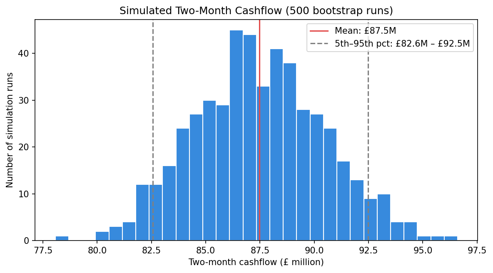
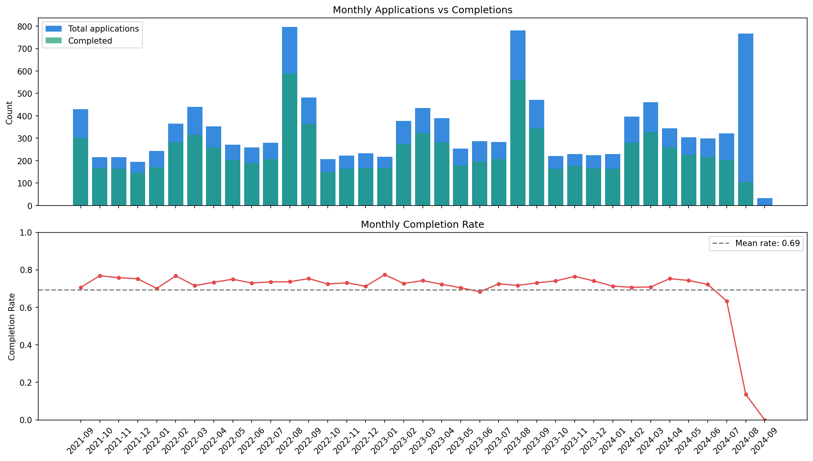
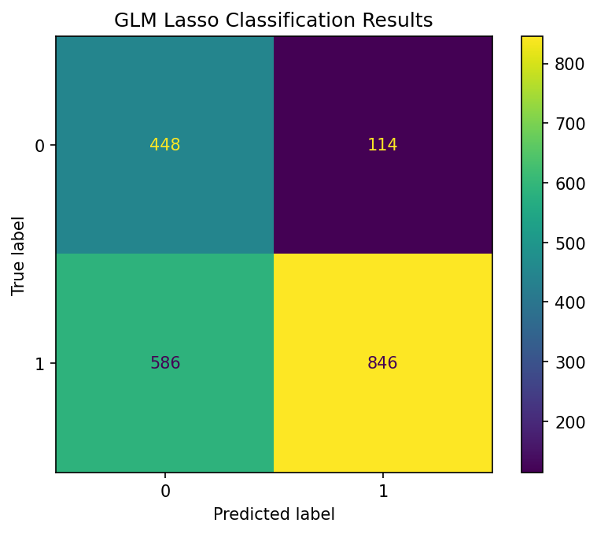

# Mortgage Pipeline Forecasting: Completion Risk & Two-Month Cashflow

Predicting which approved mortgage applications will complete, how long they will take, and how much cash the lender should expect to advance in the next two months.

**Tools:** Python · pandas · scikit-learn · XGBoost · matplotlib / seaborn
**Methods:** Lasso logistic regression · Random Forest · Linear regression · XGBoost · Bootstrap simulation

---

## Business Problem

A mortgage lender approves thousands of applications, but not every approved case reaches completion, and completion times vary widely. This creates two planning problems for the funding and balance-sheet teams:

1. **Which approved cases are at risk of falling through?** Early flags allow intervention before a case is lost.
2. **How much money will actually be advanced, and when?** Simple pipeline counts overstate expected cashflow because they ignore drop-outs and delays.

This project builds a forecasting framework that answers both questions and turns the answer into a cashflow range the business can plan against.

## Key Results

| Question | Model chosen | Result |
|---|---|---|
| Will the case complete? | Lasso logistic regression | ROC AUC 0.79 · catches **80% of non-completing cases** |
| How long will it take? | XGBoost regression | R² 0.46 · average error ≈ **8 days** |
| How much cash in the next 2 months? | Bootstrap (500 runs) | **£87.5M expected**, 90% range £82.6M – £92.5M |

**Business takeaway:** the funding team can plan around £87.5M, keep reserves sized to the £82.6M downside case, and use the completion model to flag high-risk applications early.



---

## Approach

### 1. Data preparation
- **12,535 approved applications**, grouped into five areas: loan metrics, application source, applicant profile, property attributes, and timing.
- **Removed the latest three months**: these cases were still in progress and showed artificially low completion rates (see chart below).
- **Removed negative completion durations**, which are not operationally possible.
- **Chronological train/test split** (before vs. after 1 Jan 2024), so the model is tested the way it would be used: on future applications. All imputation values and history-based features are learned from the training period only.



### 2. Feature engineering
Business-driven features rather than raw columns only:

| Feature | Business meaning |
|---|---|
| `LTV` and `High_LTV_Flag` (> 0.85) | Leverage: how much of the property is financed |
| `Total_Income`, `Income_Multiplier` | Affordability: loan size relative to household income |
| `LTV_x_Multiplier` | Cases that are both highly leveraged *and* stretched |
| `Is_New_Build` | New-build properties follow a different completion process |
| `Approval_Month`, `Approval_Quarter`, `Monthly_Avg_Delay` | Seasonal and operational timing effects |
| Log of loan, valuation, income | Reduce the influence of very large values |

### 3. Improving the baseline model
The project started from an existing analyst model. Key fixes:
- Category codes (country, source, property type) were treated as numbers, creating a false ordering → **one-hot encoded**.
- Missing values were filled with zero → **median / mode imputation**, with zero used only where it is true (no second applicant = zero second income).
- The time-to-completion model was trained on *uncompleted* cases with a duration of zero → **trained on completed cases only**.
- A random split was used → **chronological split** to avoid overstating performance.

### 4. Completion probability: Lasso vs Random Forest

| Model | Accuracy | ROC AUC | Recall (non-completed) | Recall (completed) |
|---|---|---|---|---|
| **Lasso logistic regression** | 0.649 | 0.791 | **0.80** | 0.59 |
| Random Forest | 0.681 | 0.788 | 0.71 | 0.67 |

The goal is to **catch cases that will fall through**, so recall on non-completed cases matters more than headline accuracy. The decision threshold was raised to 0.55 for this reason. The two models perform almost identically overall, which suggests the problem is largely linear. Lasso is preferred because it is simpler, easier to explain to stakeholders, and better at catching drop-outs.

**Main drivers:** property age and new-build status are the strongest predictors of completion.



### 5. Time to completion: Linear Regression vs XGBoost

| Model | R² | RMSE | MAE |
|---|---|---|---|
| **XGBoost** | 0.462 | 10.31 days | 8.18 days |
| Linear Regression | 0.427 | 10.64 days | 8.43 days |

XGBoost is only slightly better. This points to a **data limitation rather than a modelling one**: process-level information (legal progress, property chain length) is not in the dataset.

**Main drivers:** approval timing, LTV, and income multiplier. More financially stretched applicants take longer to complete.

### 6. Two-month cashflow forecast
The two models are combined in a **500-run bootstrap simulation**. In each run, the models are retrained on resampled data. Each open case is then scored for (a) whether it completes and (b) whether it completes within 61 days. The loan amounts of qualifying cases are summed.

| Statistic | Value |
|---|---|
| Mean | £87,468,222 |
| Median | £87,357,500 |
| 5th percentile | £82,559,700 |
| 95th percentile | £92,484,700 |

A range is more useful than a single number: the 5th percentile gives a cautious lower bound for setting liquidity reserves.

---

## Limitations & Next Steps
- The data only contains information available at approval. Adding **process-level data** (legal status, chain length) and **macro indicators** (interest rates) is likely to improve accuracy more than further model tuning.
- The forecast assumes future cases behave like past cases. It should be re-run as new completions are recorded.

## Repository Structure
```
├── README.md
├── notebooks/
│   └── pipeline_analysis.ipynb   # full analysis: cleaning → models → simulation
├── report/
│   └── A Data-Driven Forecast of Mortgage Completions.pdf   # written business report
├── images/                       # charts used in this README (generated by the notebook)
├── requirements.txt
└── .gitignore                    # keeps data/ out of the repository
```

## How to Run
```bash
pip install -r requirements.txt
# place Pipeline3.csv in data/
jupyter notebook notebooks/pipeline_analysis.ipynb
```
> The dataset was provided for University of Bath coursework (MN50752 Data Mining & Machine Learning) and is not included in this repository.
